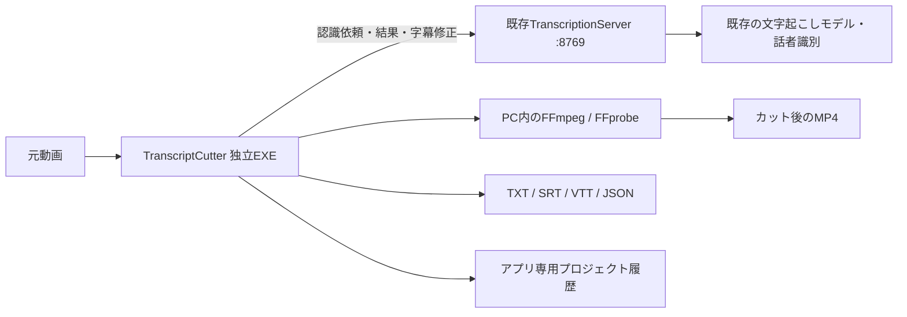

# TranscriptCutter v0.2611.0

Windows用の動画文字起こし・カットアプリです。画面をEXEへ埋め込んだ独立アプリで、文字起こしには既存のTranscriptionServerを使用します。



## 起動

`release\TranscriptCutter-v0.2611.0.exe` を起動します。既存TranscriptionServerをDevServerなどから起動し、接続先を `http://127.0.0.1:8769` とします。本アプリはサーバーを自動起動・停止しません。

動画の読取・書き出しにはFFmpegとFFprobeが必要です。EXE隣の `bin`、PATH、既存のWinGet版FFmpegから検出します。WebView2 Runtimeも必要です。文字起こしモデルはサーバー側の既存キャッシュを利用し、本アプリへ複製しません。

## 使い方

1. 「動画を開く」でPC内の動画を選択します。フォルダーのパスを入力して移動することもできます。
2. モデル・処理方式・話者識別を選択し、「文字起こし開始」。サーバーが公開するローカルエンジンのみ表示します。未対応モデルでは話者識別を無効にします。
3. 字幕の時刻を押すと動画を移動できます。本文・話者を直し「字幕の変更を保存」。字幕の編集はサーバーの認識結果にも保存されます。
4. 動画の現在位置、時刻の直接入力、選択した字幕からカット範囲を追加します。「選択範囲を残す」「選択範囲を除く」を選べます。複数範囲は時間順に連結され、重複は統合されます。
5. 保存先と保存名を指定し、MP4動画や字幕を保存します。字幕は元動画の時間軸とカット後の時間軸を選べます。

元動画と同名の既存出力は上書きしません。動画はH.264/AACで再エンコードするため画質・容量が変わります。音声は先頭の1トラックを使用し、字幕・データトラックはMP4へ埋め込みません。元ファイルには手を加えません。

## 保存と再開

- プロジェクト履歴：`%LOCALAPPDATA%\local.transcriptcutter.app\projects.json`（実際の場所はTauriのapp_local_data_dir）。元動画パス、認識ジョブID、範囲、保存先を最大100件保持します。
- 認識結果・編集：既存TranscriptionServerの保存先。本アプリからサーバー上の元データや認識履歴を削除しません。
- カット動画・字幕：指定した保存先へ別ファイルとして保存します。
- 認識を受け付けた後はアプリを閉じてもサーバーで認識が続きます。送信中・動画書き出し中は、中止または完了後に閉じられます。
- 認証値はRustのメモリ内だけで保持します。外部APIへの自動切り替えはありません。

## 制限

- Windows WebView2が対応しない動画コーデックはプレビューできない場合があります。FFmpegのカット・文字起こしは別に実行できます。ローカルファイル対象で、ネットワーク共有は対象外です。
- カットは最大200範囲。映像のフレーム・音声のサンプル単位で端点に丸めがあり、表示時刻と数十ms程度の差が出る場合があります。
- 字幕を途中でカットした場合、表示時間を切り詰めますが、文そのものは自動分割しません。必要に応じて字幕を編集してください。
- サーバーで結果を削除すると履歴からの再取得はできません。動画の移動後は改めて選択してください。
- 長時間/大容量動画、GPU、複数話者の精度は開発試験と別に受入確認が必要です。

## 開発

Node.js 22以降、Rust/MSVC、WebView2が必要です。PowerShellはpwshを使用します。

```pwsh
npm ci
npm test
npm run build:web
cargo test --manifest-path src-tauri/Cargo.toml --locked
npm run build
```

実FFmpeg試験は `TC_MEDIA_TEST=1`、稼働サーバーの読取試験は `TC_SERVER_TEST=1` を設定します。通常の `cargo test` では実環境の試験はスキップされます。合成音声での実認識試験は実装報告書を参照してください。

`web/transcript-utils.mjs` と対応テストは既存 `Services/transcription-server` の時刻・字幕出力ヘルパーを移植しています。既存Web画面・AI Room・MeetingVisualizerは変更しません。
