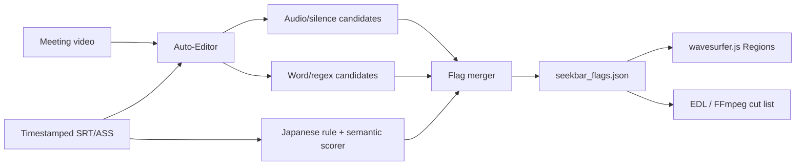
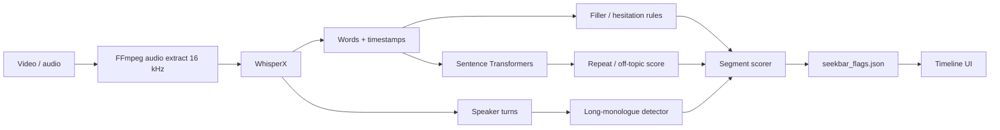
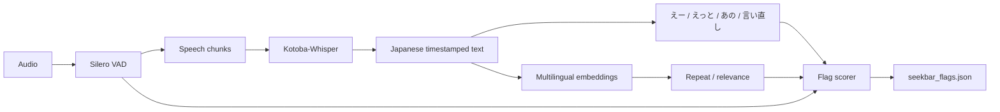
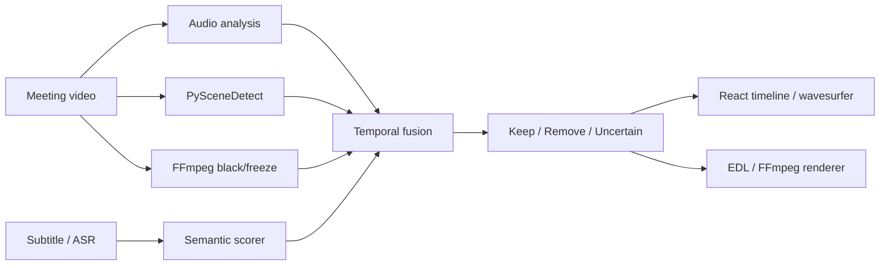

# 会議動画の自動カット候補検出に使えるOSS／オープンソース・ワークフロー調査

## エグゼクティブサマリー

会議動画に対して「この時間帯は残す／削る／要確認」とシークバー上へ候補を出す用途では、**単一のOSSで沈黙・話者交代・フィラー・内容の薄さ・重複・スライド変化まで高精度に判断する完成品は、現時点では見当たりません**。実用的なのは、複数の検出器を時間軸上で統合するパイプラインです。特に、既にタイムスタンプ付き字幕がある場合と、字幕がない場合では処理を分けるのが合理的です。

最も短期間でPoCを作るなら、第一候補は **Auto-Editor + 字幕ルール + 独自スコアリング**です。Auto-Editorは音声量ベースのカットだけでなく、埋め込み字幕または同名の `.srt` / `.ass` を読み、字幕行や単語を条件に編集できます。たとえば `"um"` 相当の語を `not word:` で反転させるような編集ルールを作れ、編集結果はCMX 3600 EDL、Premiere XML、Resolve/FCPXML、Kdenlive、Shotcut、独自JSON系タイムラインへ出力できます。現在も活発に開発されており、GitHubは約5.8k starsです。 citeturn416827search0turn416827search1turn416827search2turn416827search3turn994430search2turn994430search27

字幕がない場合の最も有力なベースラインは、**faster-whisper または whisper.cpp → pyannote.audio → 字幕／意味解析 → FFmpeg/Auto-Editor** です。WhisperXを使えばASR、word-level timestamp、VAD、pyannoteベースの話者分離まで一体化でき、実装工数を減らせます。WhisperXはREADME上でlarge-v2を最大約70×リアルタイム、8GB未満のGPUメモリで動かす構成を示しており、GitHubは約25.1k starsです。 citeturn115597search0turn994430search1

日本語を重視する場合は、Whisper系バックエンドに **Kotoba-Whisper** を組み込む価値があります。Kotoba-Whisperは日本語向けにdistillされたモデルで、公式モデルカードではlarge-v3比6.3倍の相対速度を掲げ、ReazonSpeech・JSUT・CommonVoice日本語で評価されています。faster-whisper用変換済みモデルとwhisper.cpp用ウェイトも提供されています。 citeturn590012search0turn590012search1turn590012search3

「長い独演」「脱線」「重複説明」の判定は、音響処理ではなく**意味処理層**を別に持つべきです。字幕を10～30秒程度のチャンクへ分け、Sentence Transformersで意味埋め込みを作れば、近接チャンク間や会議全体との類似度から繰り返しを検出できます。議題や会議タイトルの埋め込みとの距離を使えば「オフトピックらしさ」もヒューリスティックに測れます。Sentence Transformersには日本語を含む50言語以上対応の多言語モデルがあります。より柔軟な「残す価値」の判断には、llama.cppでローカルLLMをAPI化し、JSON Schema制約付きで `keep/remove/uncertain` を返させる構成が可能です。 citeturn403506search5turn403506search6turn183081search1turn183081search0

UIは **wavesurfer.js Regions** が最も扱いやすい選択です。Regionsプラグインは時間区間のオーバーレイを正式サポートし、TimelineやMinimapも利用できます。BSD-3-Clauseで、GitHub約10.5k stars、v8系列も現在更新されています。映像編集ソフト風の複数レーンが必要なら、MITの `@xzdarcy/react-timeline-editor` が適します。 citeturn999770search0turn999770search1turn999770search2turn999770search3

推奨優先順位は次の通りです。

1. **字幕あり最速PoC**: Auto-Editor + 字幕ルール + FFmpeg + wavesurfer.js  
2. **字幕なし高精度**: WhisperX + pyannote.audio + Semantic/LLM scorer + wavesurfer.js  
3. **日本語・軽量運用**: faster-whisper/Kotoba-Whisper + Silero VAD +独自字幕解析  
4. **映像・スライド変化まで統合**: 上記 + PySceneDetect + FFmpeg visual detectors

## 評価軸と検出信号

「カット候補」を直接二値判定すると誤削除のリスクが高いため、内部的には各時間区間に複数の証拠を保存し、最後に `keep / remove / uncertain` へ集約する設計が適します。沈黙、発話、話者、フィラー、意味的重要度、重複、映像変化は検出原理が異なるためです。

### 入力形態

**字幕あり**では、既存字幕を一次情報として使うべきです。Auto-Editorは字幕ストリームに加え、入力動画と同名の `.srt` または `.ass` をsidecarとして自動ロードでき、`--edit subtitle`、`word:`、正規表現で時間範囲を抽出できます。したがって今回の「既にtimestamped speech-subtitle dataがある」条件と非常に相性がよいです。 citeturn416827search1

Sentence TransformersやLLMはSRT自体をネイティブ入力するわけではありませんが、字幕をJSONへ正規化して `start/end/text` ごとに処理すれば利用できます。Sentence Transformersは日本語を含む多言語テキストを直接embedding化できます。 citeturn403506search5turn403506search6

**字幕なし**では、WhisperX、faster-whisper、whisper.cpp、あるいはKotoba-WhisperをASR層にします。whisper.cppにはマイク入力のリアルタイム例、HTTP server、WASM例があり、Silero VADを組み込んだCLIも提供されています。 citeturn403506search0turn403506search1turn403506search3

**音声のみ**でも、FFmpeg、Silero VAD、pyannote.audio、Whisper系はそのまま利用できます。一方、PySceneDetectなどの映像シグナルは当然利用できません。PySceneDetectは動画のカット／トランジションを検出するPythonライブラリ／CLIです。 citeturn416827search6turn416827search8

### 検出信号別の適性

| 検出信号 | 有力OSS | 実装上の扱い |
|---|---|---|
| 沈黙 | FFmpeg `silencedetect`, Silero VAD, Auto-Editor, whisper.cpp VAD | 最も確実なremove候補。短いポーズは残す閾値が必要。FFmpegは`lavfi.silence_start/end`を時間付きで出せます。 citeturn761422search2turn115597search4 |
| 発話／非発話 | Silero VAD, pyannote, WhisperX | ASR前の分割や、字幕のない空白区間の判定に有効。Sileroは30ms超のチャンクをCPU 1スレッドで1ms未満としています。 citeturn115597search4 |
| 話者交代 | pyannote.audio, WhisperX | 会話ターン境界としてカット候補境界を補正。pyannoteはspeaker diarizationのほかspeech activity、speaker change、overlap系を提供します。 citeturn115597search2turn617602search5 |
| フィラー・言い淀み | Auto-Editor `word:`、ASR字幕＋辞書 | 日本語なら「えー」「えっと」「あのー」「そのー」等をword/subtitle timestampから候補化。Auto-Editorはword/subtitle条件を直接編集ルール化できます。 citeturn416827search1 |
| 長い独演 | pyannote＋時間集計 | 同一話者が長時間続く区間を検出。ただし「長い＝不要」ではないためuncertain扱いが適切。 |
| 低情報量 | Sentence Transformers / ローカルLLM | 要旨との類似度、情報密度、決定事項・質問・回答の有無を判定。Sentence Transformersはsemantic similarity/paraphrase mining用途を公式にサポートします。 citeturn403506search5 |
| オフトピック | Sentence Transformers / LLM | 議題・タイトル・会議要旨とのembedding距離、またはLLM分類。 |
| 繰り返し | Sentence Transformers + FAISS | 直前または全会議のチャンクとの高類似度を検出。FAISSは大規模ベクトル類似検索をCPU/GPUで扱えます。 citeturn403506search4 |
| スライド／画面変化 | PySceneDetect, FFmpeg `blackdetect`, `freezedetect` | スライド切替そのものはshot detectionの閾値調整で近似。ブラック画面・freezeはFFmpegでtimestamp付き検出。 citeturn761422search0turn761422search1turn416827search6 |

重要なのは、**話者交代やスライド変化は「削る理由」ではなく「区間境界を置く理由」**として使うことです。一方、長い沈黙、フィラーだけの発話、直前内容のほぼ完全な反復はremoveスコアを直接上げやすい信号です。オフトピックや低情報量は文脈依存性が強いため、初期PoCでは `uncertain` に倒すのが安全です。

## OSS候補比較

下表の「字幕入力」は、字幕ファイル／字幕ストリームを**ネイティブに編集条件として扱えるか**を区別しています。

| OSS | Repo | 主な信号 | 入力 | 出力 | License | Integration / 成熟度 |
|---|---|---|---|---|---|---|
| **Auto-Editor** | [GitHub](https://github.com/WyattBlue/auto-editor) | 音量、字幕、単語、正規表現、motion | 動画・音声、**字幕○**、字幕なしはWhisperサブコマンド | EDL、Premiere XML、FCPXML、Kdenlive、Shotcut、clip sequence、v3 timeline | Unlicense / Public Domain | CLI中心。字幕から直接編集できる点が最大の強み。約5.8k stars、現在も活発。 citeturn994430search2turn416827search1turn416827search2 |
| **FFmpeg** | [GitHub](https://github.com/FFmpeg/FFmpeg) | silence、black、freeze、scene系 | 動画・音声、字幕streamも処理可能 | metadata/log、segment list、ffconcat、実動画 | LGPL/GPL構成依存 | 最も成熟した基盤。検出結果をJSONへ変換する薄いラッパーが必要。`silencedetect`は時刻metadataを出力。 citeturn761422search2turn761422search4 |
| **WhisperX** | [GitHub](https://github.com/m-bain/whisperX) | ASR、VAD、word timestamp、diarization | 動画由来音声・音声、字幕× | timestamped transcript＋speaker | BSD-2-Clause | Python。字幕なしパイプラインの一体型候補。約25.1k stars。 citeturn115597search0turn994430search1 |
| **faster-whisper** | [GitHub](https://github.com/SYSTRAN/faster-whisper) | ASR、word timestamp、VAD filter | 音声、字幕× | Python segment/word objects | MIT | Python/API組込み容易。約26.5k stars。GPU/CPU量子化。 citeturn994430search3turn617602search0 |
| **whisper.cpp** | [GitHub](https://github.com/ggml-org/whisper.cpp) | ASR、VAD、簡易speaker-turn | 音声、動画由来音声、字幕× | CLI timestamps、HTTP API | MIT | C/C++、CPU/Apple/Android/iOS/WASM向け。リアルタイム例あり。 citeturn403506search0turn403506search2turn403506search3 |
| **Kotoba-Whisper** | [GitHub](https://github.com/kotoba-tech/kotoba-whisper) | 日本語ASR、モデルによって句読点／話者分離 | 音声、字幕× | timestamped transcript | モデルによりApache-2.0/MIT等 | 日本語優先時のASRモデル。faster-whisper/whisper.cpp用派生あり。 citeturn590012search0turn590012search1turn590012search3 |
| **pyannote.audio** | [GitHub](https://github.com/pyannote/pyannote-audio) | VAD、speaker change、diarization、overlap | 音声 | speaker/time segments | MIT | Python-first。会議の話者ターン抽出に最有力。約10.8k stars。 citeturn115597search2turn115597search3turn617602search5 |
| **Silero VAD** | [GitHub](https://github.com/snakers4/silero-vad) | speech/non-speech | 音声 | speech timestamps | MIT | PyTorch/ONNX、モデル約2MB。CPUで非常に軽量。 citeturn115597search4turn115597search5 |
| **PySceneDetect** | [GitHub](https://github.com/Breakthrough/PySceneDetect) | shot cut、fade、content/adaptive scene | 動画 | CSV、EDL、FCPXML、frames | BSD-3-Clause | CLI/Python API。0.7.3が2026-11-08公開、約5.4k stars。 citeturn416827search5turn416827search9turn994430search5turn617602search1 |
| **Sentence Transformers** | [GitHub](https://github.com/huggingface/sentence-transformers) | semantic similarity、paraphrase、embedding | テキスト。**SRTは要parse** | vectors/scores | Apache-2.0 | 日本語対応multilingual modelあり。重複・脱線・低情報量の独自scoreに適する。 citeturn403506search5turn403506search6turn403506search7 |
| **llama.cpp** | [GitHub](https://github.com/ggml-org/llama.cpp) | LLMによる内容分類 | テキスト／対応モデルではmultimodal | JSON Schema制約可能 | MIT ※モデル別license別途 | REST APIが強力。ローカルでkeep/remove理由を生成可能。 citeturn183081search1turn183081search0 |
| **wavesurfer.js** | [GitHub](https://github.com/katspaugh/wavesurfer.js) | UIのみ | audio/video time axis | Regions UI | BSD-3-Clause | Regions・Timeline・Minimap。seekbar flag表示に最適。約10.5k stars。 citeturn999770search0turn999770search1 |
| **React Timeline Editor** | [GitHub](https://github.com/xzdarcy/react-timeline-editor) | UIのみ | timeline JSON | editable timeline | MIT | 複数レーン表示に向く。字幕、speaker、cut candidateを別レーン化しやすい。 citeturn999770search3turn999770search4 |

古い `videojs-markers` もseekbar marker用途には使えますが、リポジトリ自身が「not actively maintained」と明記しているため、新規実装ではwavesurfer.jsまたは自前Video.js overlayを優先した方がよいです。 citeturn999770search6

## 精度・性能・日本語・運用性

### ASR

faster-whisperの公式READMEでは、RTX 3070 Ti 8GBで13分音声をlarge-v2、beam 5、FP16 batch size 8で約17秒、VRAM約6.1GBというベンチマークを掲載しています。同じ表で通常faster-whisper FP16は約63秒、openai/whisperは143秒です。CPU i7-12700Kではsmallモデル・INT8で約102秒、batch size 8なら約51秒とされています。ただしこれは特定ハードウェア・データセット・バージョンでの比較であり、会議日本語の実測値としてそのまま扱うべきではありません。 citeturn115597search1

WhisperXはbatched inferenceでlarge-v2を「70× realtime」、large-v2で8GB未満のGPUメモリとしています。またVAD前処理とforced alignmentを組み合わせ、word-level timestampsとpyannote diarizationを提供します。長時間会議では「ASR→alignment→diarization」を個別構築するより運用が簡単です。 citeturn115597search0

日本語ではKotoba-Whisperが有力です。公式モデルカードはReazonSpeech約720万クリップを用いたv2.0を説明し、large-v3比6.3倍の相対速度を掲げています。またCTranslate2/faster-whisper版の公式ベンチマークには50.3分の日本語音声をApple M2 Proで処理した比較があります。 citeturn590012search0turn590012search1

### VAD・話者分離

Silero VADはモデルが約2MB、30ms以上のチャンクをCPU 1スレッドで1ms未満としており、6000以上の言語を含むデータで学習したと説明しています。VADだけ欲しい場合はpyannoteよりはるかに軽量です。公式quality metricsでは複数の会議・音声セットに対する比較も公開されています。 citeturn115597search4turn115597search5

pyannoteの`community-1` diarizationは、公式ベンチマークでAliMeeting channel 1のDER 20.3%、AMI IHM 17.0%、DIHARD3 20.2%などを報告しています。また約1時間のAMI音声について、community-1を1時間音声あたり31秒としているベンチマークがあります。これはASRとは独立に回せるため、長時間会議をジョブ分割して処理しやすい構成です。 citeturn115597search2

### 映像解析

PySceneDetectは画面全体の変化を使う`detect-content`、適応型検出、fade向けthreshold detectorを提供し、CSVやEDL/FCP形式へ出せます。2026年11月8日に0.7.3が公開されており、現在もメンテナンスが続いています。 citeturn416827search6turn416827search9

会議画面ではカメラ切替やZoom/Teamsのレイアウト変更もscene changeとして拾うため、**PySceneDetectの結果をそのまま「スライド変更」と見なすのは危険**です。実装では「画面のスライド領域だけcropしてscene scoreを計算」する、またはOCR/画像embeddingを追加する方が安定します。FFmpegの`blackdetect`、`freezedetect`はブラックアウトや共有停止といった補助シグナルとして使えます。 citeturn761422search0turn761422search1

### ライセンス・成熟度

今回の主要候補は比較的扱いやすいライセンスです。Auto-EditorはPublic Domain/Unlicense、faster-whisper・pyannote.audio・Silero VAD・whisper.cpp・llama.cppはMIT、WhisperXはBSD-2-Clause、PySceneDetectとwavesurfer.jsはBSD-3-Clause、Sentence TransformersはApache-2.0です。モデルウェイトには別ライセンスが付く場合があるため、商用製品へ組み込む場合は**コードのlicenseとモデルのlicenseを別々に確認**する必要があります。 citeturn994430search35turn617602search0turn115597search3turn115597search4turn403506search2turn183081search0turn617602search1turn999770search1turn403506search7

公開された「企業本番導入」の明示例はツールごとにばらつきがあり、GitHub starsをそのままproduction adoptionと見なすべきではありません。一方、WhisperX約25.1k、faster-whisper約26.5k、pyannote約10.8k、wavesurfer.js約10.5kとコミュニティ規模は十分大きく、WhisperX自身もpyannoteとfaster-whisperを組み合わせているため、組み合わせの実績という意味では強いです。 citeturn994430search1turn994430search3turn617602search5turn999770search0turn115597search0

## 推奨オプションと最小プロトタイプ

### Auto-Editor中心：字幕あり最短PoC

**向くケース:** 既にtimestamped subtitlesがあり、「まずシークバー上へ削除候補を出したい」「既存編集ツールへ渡したい」。

**長所:** 字幕をネイティブに編集条件として扱え、音声量との組合せもでき、EDLや主要NLE形式へそのままexportできます。既存字幕を活かせるためASRコストがありません。 citeturn416827search0turn416827search1turn416827search2

**短所:** 低情報量、脱線、意味的重複を自動理解する機能はありません。フィラーは辞書ルールになります。



最小実装は、字幕を内部JSONへparseし、「沈黙 > 1.2秒」「フィラーだけの区間」「短い相槌」「字幕なし区間」をremove候補にします。Sentence Transformersを後付けして重複判定を加えれば、PoCとしてかなり実用的です。Semantic判断は初期段階では自動removeせず`uncertain`に限定するのが安全です。

### WhisperX中心：字幕なし高精度バッチ

**向くケース:** 1～3時間級会議、複数話者、字幕なし、GPUサーバー利用可。

**長所:** ASR、VAD、word alignment、diarizationを一体化できます。日本語Whisperモデルへの差し替えも設計上可能です。WhisperX自体はfaster-whisperとpyannoteを利用します。 citeturn115597search0

**短所:** GPU/PyTorch周りの依存が重いこと、speaker diarizationが常に正確ではないこと、意味判定は別実装が必要なことです。



ここでは話者ターンを**cut boundary候補**として使い、speaker turnの直前直後200～400msをカット禁止領域にすると、語尾や次話者の冒頭を切りにくくなります。

### Kotoba-Whisper + Silero：日本語・軽量構成

**向くケース:** 日本語中心、GPUが限定的、ローカル処理重視。

Kotoba-Whisperは日本語向けで、faster-whisper/whisper.cpp形式も提供されています。Silero VADは非常に軽量で、音声区間だけをASRへ流せます。 citeturn590012search0turn590012search1turn115597search4

**長所:** 日本語ASRに最適化しやすく、VADとASRを分離してスケールできます。CPU/Apple Silicon用にwhisper.cppへ振ることも可能です。whisper.cppはリアルタイム入力やHTTP server例も提供します。 citeturn403506search0turn403506search3

**短所:** WhisperXほど「ASR＋alignment＋diarization」が一体化していないため、話者分離が必要ならpyannoteを追加します。



リアルタイムの会議中プレビューではVADとASRだけを先に走らせ、意味スコアや重複判定は会議終了後のbatch処理に分けるのがよい設計です。

### 映像・スライドシグナル統合型

**向くケース:** 画面共有、プレゼン、議事録動画など、視覚情報が編集判断に重要。

PySceneDetectはscene listをCSV/EDL/FCPへ出せるほかPython APIで直接利用できます。FFmpegはblack/freeze/silenceのtimestamp metadataを取得できます。 citeturn416827search5turn416827search7turn761422search0turn761422search1

**長所:** 「スライドが切り替わった直後は残す」「共有画面が止まったまま無言なら削除候補」のようなマルチモーダルルールを作れます。

**短所:** 会議UIのレイアウト変更をスライド変更と誤認しやすく、映像cropやROI設定が必要になります。



この構成ではPySceneDetectのscene transitionをremove判定には直接使わず、**区間境界の補助特徴**として与える方が適切です。

## 実装設計とseekbarデータモデル

字幕がある場合は、最初にASRを回す必要はありません。既存字幕をcanonical timelineへ変換し、音声シグナルだけFFmpeg/Sileroから追加します。次に字幕からフィラー、重複、topic relevanceを計算し、最後にsegment mergerで近接区間を統合します。字幕と音声タイムスタンプに多少のずれがある場合でも、カットポイントを無音境界へsnapすることで自然な編集になります。

字幕がない場合は、`video → audio → VAD → ASR → optional diarization → semantic analysis` の順が安定します。VADをASR前に入れることで、無音の長い会議や待機時間の処理量を減らせます。whisper.cppもSilero VADを前段に使用して「speech segmentsだけをWhisperへ渡す」設計を公式に採用しています。 citeturn403506search1

最終的な判定は、単一スコアよりも理由別スコアを保持する方がUIとデバッグの両方に有利です。たとえば、

`remove_score = 0.35*silence + 0.20*filler + 0.20*duplicate + 0.15*offtopic + 0.10*visual_idle`

のように始め、`remove_score >= 0.8`のみremove、`0.45–0.8`をuncertainとします。ただし係数は実会議データで調整すべきで、意味系スコアは初期段階では低めにするのが安全です。

推奨JSON Schemaの例は次の形です。

```json
{
  "media_id": "meeting-2026-11-10-001",
  "duration_ms": 5429123,
  "language": "ja",
  "flags": [
    {
      "id": "seg_0042",
      "start_ms": 483120,
      "end_ms": 491850,
      "decision": "remove",
      "confidence": 0.94,
      "reasons": [
        {
          "type": "silence",
          "score": 0.99,
          "source": "silero-vad"
        },
        {
          "type": "low_information",
          "score": 0.72,
          "source": "semantic-scorer"
        }
      ],
      "speaker_ids": [],
      "subtitle_ids": ["sub_183"],
      "transcript": "",
      "boundary": {
        "start_reason": "speech_end",
        "end_reason": "speech_start",
        "snapped_to_silence": true
      },
      "review": {
        "status": "unreviewed",
        "user_override": null
      }
    },
    {
      "id": "seg_0043",
      "start_ms": 491850,
      "end_ms": 506400,
      "decision": "uncertain",
      "confidence": 0.67,
      "reasons": [
        {
          "type": "repetition",
          "score": 0.81,
          "source": "sentence-transformers"
        },
        {
          "type": "speaker_monologue",
          "score": 0.58,
          "source": "pyannote"
        }
      ],
      "speaker_ids": ["SPEAKER_02"],
      "subtitle_ids": ["sub_184", "sub_185"],
      "transcript": "先ほどの内容をもう一度整理しますと…",
      "review": {
        "status": "unreviewed",
        "user_override": null
      }
    }
  ]
}
```

UI側ではこのJSONをwavesurfer.js Regionsへマッピングし、`remove`、`uncertain`、`keep`を別のregion classとして描画します。Regionsは時間範囲のoverlayを正式に提供しているため、ドラッグで開始・終了点を修正し、その変更を同じJSONへ書き戻す形が自然です。複数レーンが必要になったら、`speech / speaker / semantic / visual / final decision` をReact Timeline Editorの別rowへ分けると、なぜ削除候補になったかをユーザーが追跡できます。 citeturn999770search0turn999770search3

実際に動画を生成する段階では、JSONからkeep区間をFFmpegのtrim/concatへ変換するか、Auto-Editorのtimeline/EDLへ変換します。FFmpegのsegment muxerはCSVや`ffconcat`形式のsegment listを生成でき、concat demuxerで連結できます。 citeturn761422search3turn761422search4

## 推奨最終構成

開発リスクと成果のバランスが最も良いのは、**検出エンジンと編集UIを分離し、共通のtime-range JSONを契約にする構成**です。

字幕ありでは、`SRT/既存JSON → filler rules + semantic similarity` と `FFmpeg/Silero → silence` を並列処理し、必要に応じてPySceneDetectを追加します。字幕なしではその前段にWhisperX、または日本語向けKotoba-Whisper/faster-whisperを追加します。

初期プロトタイプの技術スタックとしては、**Python FastAPI系バックエンド + FFmpeg + Auto-Editor + Sentence Transformers + wavesurfer.js** が最も実装が単純です。話者情報が本当に編集精度へ寄与すると確認できた時点でpyannoteを追加し、日本語ASR品質が問題になった時点でKotoba-Whisperへ寄せるのが合理的です。Auto-Editorは既存字幕から直接編集区間を作れ、PySceneDetectは2026年11月にもリリースがあり、wavesurfer.jsもv8系列が活発に更新されているため、基盤OSSとしてのメンテナンス状況も良好です。 citeturn416827search1turn416827search9turn999770search2

意味判定については、最初からLLMに全権を与えるより、**決定論的信号 → semantic similarity → LLM review** の三段構成を推奨します。つまり、長い沈黙や字幕のない区間は高確度remove、重複やフィラー主体は中～高確度remove、脱線や低情報量はuncertain、重要語・決定事項・質問応答・新しいスライド直後はkeep方向へ重み付けする設計です。これにより、ユーザーがシークバー上で「なぜこの区間が削除候補なのか」を確認・修正できる、人間中心の半自動編集システムになります。